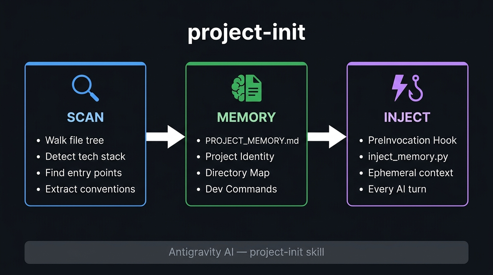

<div align="center">

# project-init — Codebase Memory for Antigravity AI

<p align="center">
  <a href="https://github.com/rootkind35-del/project-init/blob/main/SKILL.md" target="_blank"></a>&nbsp;
  <a href="https://github.com/rootkind35-del/project-init/issues" target="_blank"></a>
</p>

[](https://www.python.org/downloads/)
[](https://antigravity.dev)
[](LICENSE)
[](https://github.com/rootkind35-del/project-init/releases)

[Features](#-key-features) · [Get Started](#-get-started) · [How It Works](#-how-it-works) · [Community](#-community)

</div>

---

> 🤝 **Contributions welcome!** Vote on roadmap items or propose new features at [`Issues`](https://github.com/rootkind35-del/project-init/issues), and see [CONTRIBUTING.md](CONTRIBUTING.md) for guidelines.

---

## 📦 Releases

> **[2026-10-06]** [v1.0.0](https://github.com/rootkind35-del/project-init/releases/tag/v1.0.0) — Initial public release. Python scanner, markdown writer, PreInvocation hook.

---

## ✨ Key Features

**project-init** is an [Antigravity](https://antigravity.dev) skill that replicates the `/init` workflow from Codex and Claude Code — scan your entire codebase once, write a structured `PROJECT_MEMORY.md`, and automatically inject that context into every AI invocation for the rest of the session.

- **One-Command Init** — Say `/init` or `"scan project"` in any language; the AI detects intent and runs the full pipeline automatically.
- **Deep Project Scanner** — `scan_project.py` walks the file tree, detects runtimes, frameworks, entry points, dev commands, and code conventions without executing any project code.
- **Structured Memory File** — Writes `PROJECT_MEMORY.md` to the workspace root: project identity, directory map, tech stack, key files, and detected dev commands in a single readable document.
- **Automatic Context Injection** — `inject_memory.py` runs as a `PreInvocation` hook, injecting the memory file as an ephemeral system message before every AI turn in the session.
- **Zero Config After Init** — Once the hook is installed in `.agents/hooks.json`, memory injection is fully automatic. No manual prompting required.
- **Git-Safe Output** — `PROJECT_MEMORY.md` is plain Markdown. Safe to commit — it doubles as onboarding documentation for teammates.

---

## 🚀 Get Started

**project-init** installs as a global Antigravity skill. It requires Python 3.8+ (included in most developer environments).

### Workspace Architecture

Antigravity skills live under `~/.gemini/config/skills/`. The skill registers itself globally, so it is available in every workspace. On first use in a project, it writes two files to your workspace root:

```
your-project/
├── PROJECT_MEMORY.md        ← generated memory file (commit this)
└── .agents/
    └── hooks.json           ← PreInvocation hook (commit this too)
```

<details>
<summary><b>Option 1 — Install from source (recommended)</b></summary>

Requires Git and Python 3.8+.

```bash
# Clone the skill into your global Antigravity config
git clone git@github.com:rootkind35-del/project-init.git \
  ~/.gemini/config/skills/project-init
```

That's it. Antigravity discovers skills automatically from `~/.gemini/config/skills/`.

</details>

<details>
<summary><b>Option 2 — Manual file placement</b></summary>

Download and copy the skill folder manually:

```
~/.gemini/config/skills/
└── project-init/
    ├── SKILL.md
    ├── scripts/
    │   ├── scan_project.py
    │   ├── write_memory.py
    │   └── inject_memory.py
    └── references/
        └── manual_scan.md
```

</details>

<details>
<summary><b>Option 3 — Per-workspace installation (team sharing)</b></summary>

To share the skill with your team, copy it into your project's `.agents/` directory:

```bash
git clone git@github.com:rootkind35-del/project-init.git \
  .agents/skills/project-init
```

Check `.agents/` into version control. Every team member picking up the project gains the skill automatically.

</details>

### Usage

Open Antigravity in your project workspace and say any of:

```
/init
init project
scan project
đọc toàn bộ project
ghi nhớ project
memorize codebase
```

The AI will run the full scan → memory → hook pipeline and confirm when done.

---

## 📖 How It Works

<div align="center">

</div>

The skill runs in three phases:

<details>
<summary><b>Phase 1 — SCAN</b> · scan_project.py walks the file tree</summary>

`scan_project.py` performs a pure read-only traversal of the workspace. It skips binary files, ignored directories (`node_modules`, `.git`, `__pycache__`, `dist`, etc.), and files over 128 KB.

What it collects:

| Signal | Method |
|:---|:---|
| Language breakdown | File extension census, line counts |
| Tech stack | Manifest file detection (`package.json`, `pyproject.toml`, `go.mod`, `Cargo.toml`, and 30+ others) |
| Frameworks | Regex pattern matching across file content (FastAPI, React, Django, Next.js, Gin, Axum, and 20+ more) |
| Entry points | Name-based matching (`main.py`, `index.ts`, `main.go`, `Dockerfile`, etc.) |
| Dev commands | Parsed from `package.json` scripts, `Makefile` targets, `pyproject.toml` scripts |
| Conventions | Linter config detection, test file census, type checker presence |
| Git metadata | Remote URL, current branch, last commit hash and message |

Output: a structured JSON object to stdout.

</details>

<details>
<summary><b>Phase 2 — MEMORY</b> · write_memory.py generates PROJECT_MEMORY.md</summary>

`write_memory.py` reads the JSON from Phase 1 and writes `PROJECT_MEMORY.md` to the workspace root.

Example output structure:

```markdown
# PROJECT_MEMORY — my-api

## Project Identity
| Field       | Value                    |
|-------------|--------------------------|
| Name        | my-api                   |
| Stack       | Python, FastAPI           |
| Branch      | main                     |
| Last Commit | a3f9b12 — add auth layer |
| Files       | 142                      |
| Lines       | 18,430                   |

## Directory Map
src/        — main source code
tests/      — 23 test/spec files
migrations/ — database migrations
scripts/    — build/utility scripts

## Key Files
- src/main.py      — entry point
- pyproject.toml   — Python

## Dev Commands
| Command | Script        |
|---------|---------------|
| dev     | uvicorn main  |
| test    | pytest        |

## Conventions
- Linter config: pyproject.toml
- Python type checking active (mypy/pyright)
- Tests found: 23 test/spec files
```

</details>

<details>
<summary><b>Phase 3 — INJECT</b> · inject_memory.py runs as a PreInvocation hook</summary>

After Phase 2, the skill creates `.agents/hooks.json` in the workspace root (or merges into an existing one):

```json
{
  "project-memory-injector": {
    "PreInvocation": [
      {
        "type": "command",
        "command": "python \"~/.gemini/config/skills/project-init/scripts/inject_memory.py\"",
        "timeout": 5
      }
    ]
  }
}
```

Before every AI invocation, Antigravity calls `inject_memory.py`. The script:

1. Reads `workspacePaths[0]` from stdin JSON.
2. Looks for `PROJECT_MEMORY.md` at the workspace root.
3. If found, returns `{ "injectSteps": [{ "ephemeralMessage": "=== PROJECT MEMORY ... ===" }] }`.
4. If not found (e.g. in a different project), returns `{}` silently.

The memory is injected as an `ephemeralMessage` — it appears in the model's context but not in the conversation history visible to the user.

</details>

---

## 📁 Repository Structure

```
project-init/
├── SKILL.md                      ← Antigravity skill definition (name, description, workflow)
├── scripts/
│   ├── scan_project.py           ← Phase 1: file tree walker and signal extractor
│   ├── write_memory.py           ← Phase 2: JSON → PROJECT_MEMORY.md generator
│   └── inject_memory.py          ← Phase 3: PreInvocation hook, reads memory into AI context
├── references/
│   └── manual_scan.md            ← Fallback procedure for environments without Python
└── assets/
    └── figs/
        └── architecture.jpg      ← System architecture diagram
```

---

## ⌨️ Running Scripts Directly

The scripts can be used standalone outside of Antigravity.

<details>
<summary><b>Scan a project and print JSON</b></summary>

```bash
python scripts/scan_project.py /path/to/your/project
```

</details>

<details>
<summary><b>Full pipeline: scan and write memory file</b></summary>

```bash
python scripts/scan_project.py /path/to/project \
  | python scripts/write_memory.py /path/to/project
```

This writes `PROJECT_MEMORY.md` directly into `/path/to/project/`.

</details>

<details>
<summary><b>Script reference</b></summary>

| Script | Input | Output | Purpose |
|:---|:---|:---|:---|
| `scan_project.py <root>` | Filesystem | JSON to stdout | Collect project signals |
| `write_memory.py <root>` | JSON from stdin | `PROJECT_MEMORY.md` written to `<root>` | Format and write memory |
| `inject_memory.py` | Antigravity hook JSON on stdin | Hook response JSON to stdout | Inject memory into AI context |

</details>

---

## 🌐 Community

### 🔗 Maintainer

<table>
  <tr>
    <td align="center"><a href="https://github.com/rootkind35-del"><br><strong>rootkind35-del</strong></a></td>
  </tr>
</table>

### 📮 Contact

Open a [GitHub Issue](https://github.com/rootkind35-del/project-init/issues) for bug reports, feature requests, or questions.

### 🙏 Appreciation

project-init builds on these open-source projects and platforms:

| Project | Role |
|:---|:---|
| [**Antigravity**](https://antigravity.dev) | Skill runtime, hook system, and PreInvocation contract |
| [**Codex**](https://github.com/openai/codex) | Inspiration for the `/init` memory workflow |
| [**Claude Code**](https://docs.anthropic.com/claude/docs/claude-code) | Inspiration for the session-scoped project context pattern |

### 🗺️ Roadmap

Tracked on [GitHub Issues](https://github.com/rootkind35-del/project-init/issues). Planned items:

- [ ] Incremental update — only re-scan changed files
- [ ] `.projectinitignore` support for custom exclusion rules
- [ ] Tree-sitter integration for richer code symbol extraction
- [ ] Auto-summary of recent git diff as "What changed since last init"

<div align="center">

<a href="https://github.com/rootkind35-del/project-init/graphs/contributors">
  
</a>

<p>
  
</p>

Licensed under the [MIT License](LICENSE).

</div>
